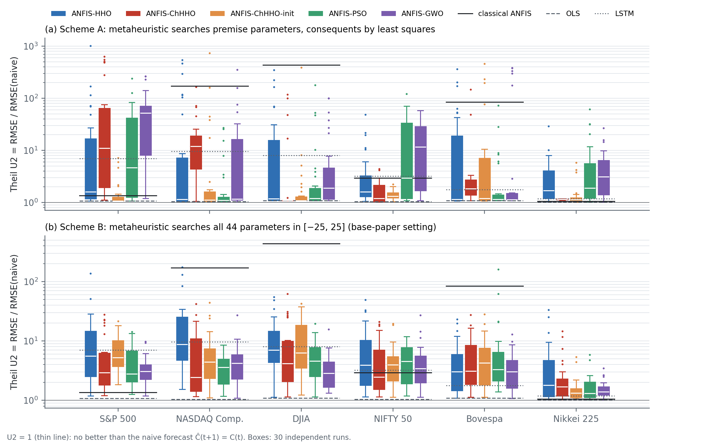

# Is chaos-enhanced ANFIS really better? A controlled replication

[](LICENSE)

[](#reproduce-everything)

Code, data pipeline and results for the replication study in

> **Are Hybrid Soft Computing Models Really Better? A Critical Review of Hybrid-versus-Standalone Forecasting
> Studies and a Controlled Replication of Chaos-Enhanced ANFIS**
> Adarsha Sagar H V, Thanu George, Zain Mahedi, Tanish Agrawal, Vaibhav S Keerthi
> Department of Computer Science and Engineering, B.M.S. College of Engineering, Bengaluru, India.
> *Manuscript under preparation; a link will be added here when it is available.*

We re-test the claim of Mohamed, Refaie Ali & Dabour (*Scientific Reports* 15:32529, 2025) that an ANFIS
trained with **chaotic Harris Hawks optimisation (ANFIS-ChHHO)** forecasts stock prices better than a
standalone ANFIS, under a leakage-free protocol with repeated runs, simple baselines and significance tests.

## Main findings

| | |
|---|---|
| Runs | 1,800 leak-free optimised runs (5 optimisers × 2 training schemes × 30 runs × 6 indices) |
| Naive forecast | **No run and no baseline beats "tomorrow's close = today's close"** on any index (Theil U2 > 1) |
| Chaos | ChHHO shows no consistent advantage over plain HHO, PSO or GWO; an ablation shows the chaotic random numbers do not help |
| The map | The quadratic map at the published setting (a = 1.4) is **periodic, not chaotic** (Lyapunov exponent −0.027, period 32) |
| Leakage | Full-series ("look-ahead") scaling changes which model looks best |



## Repository layout

| Path | What it is |
|---|---|
| `fetch_data.py` | Downloads the six daily index series from Yahoo Finance and verifies them against `data/SHA256SUMS` |
| `core.py` | Data protocols, first-order Sugeno ANFIS, HHO / ChHHO / ChHHO-init / PSO / GWO, quadratic-map Lyapunov exponent |
| `run_mh.py` | All metaheuristic runs (parallel, resumable: finished runs are skipped) |
| `baselines.py` | Naive random walk, OLS, classical hybrid-learning ANFIS, LSTM (30 seeds) |
| `analyze.py` | Metrics, Theil U2, Wilcoxon + Holm, HLN Diebold–Mariano, Friedman/Nemenyi → `results/summary.json` |
| `fig_chaos.py`, `fig_results.py` | Figures 7–11 of the paper → `figs/` |
| `results/summary.json` | Every summary number reported in the paper |
| `review/` | Values extracted from the 17 reviewed studies (Sections 3–4 of the paper) |
| `figs/` | The paper's figures |

## Setup

```bash
git clone https://github.com/MahediBuilds/anfis-chhho-replication.git
cd anfis-chhho-replication
python -m venv .venv && source .venv/bin/activate      # Windows: .venv\Scripts\activate
pip install -r requirements.txt
python fetch_data.py                                    # should print "checksum OK" six times
```

Raw prices are not stored in the repository (Yahoo Finance terms of use); `fetch_data.py` rebuilds exactly the
files used in the paper. If Yahoo ever revises its history, the script reports a checksum mismatch.

## Quick check (minutes): re-analyse our raw runs

Download `raw-results.zip` from the [latest release](https://github.com/MahediBuilds/anfis-chhho-replication/releases/latest),
unzip it into `results/` (giving `results/mh/` and `results/base/`), then

```bash
python analyze.py          # rewrites results/summary.json
python fig_chaos.py
python fig_results.py      # rewrites figs/
```

## Reproduce everything

About 75 CPU-hours in total (15 worker processes on a 16-thread laptop took roughly 5 hours of wall time).

```bash
python run_mh.py                   # protocols P1 and P1L
STAGE=P2 python run_mh.py          # protocol P2 (PowerShell: $env:STAGE="P2"; python run_mh.py)
python baselines.py                # uses a CUDA GPU for the LSTM if available
python analyze.py
python fig_chaos.py && python fig_results.py
```

| Variable | Default | Meaning |
|---|---|---|
| `WORKERS` | 15 | parallel worker processes |
| `RUNS` | 30 | independent runs per optimiser and cell |
| `BUDGET` | 50000 | objective-function evaluations per run |
| `STAGE` | (unset) | `P2` runs the scale-free return protocol |

All random seeds are fixed (`1000 + run` for the optimisers, with common random numbers across optimisers,
and `2000 + seed` for the LSTM), so re-runs give the same numbers on the same software stack.

## Experimental design in brief

- **Model:** first-order Sugeno ANFIS, inputs Open/High/Low on day *t*, target Close on day *t*+1; 2 Gaussian MFs per input, 8 rules.
- **Scheme A:** the optimiser searches the 12 premise parameters; consequents are solved by least squares.
  **Scheme B:** the optimiser searches all 44 parameters (as in the original paper).
- **Protocols:** P1 = chronological 70/30 split, scaling fitted on training data only;
  P1L = the same with full-series scaling (look-ahead leakage check); P2 = scale-free returns on the same test days.
- **Data:** S&P 500, NASDAQ Composite, Dow Jones, NIFTY 50, Bovespa, Nikkei 225; daily, 2010-01-04 to 2019-12-31.

## Contributing

Reproduction reports, bug fixes and extensions are welcome; see [CONTRIBUTING.md](CONTRIBUTING.md).
Telling us that a number did *not* reproduce is especially valuable.

## Citation

If you use this code, please cite the paper (details will be added on publication) or use
GitHub's "Cite this repository" button, which reads [CITATION.cff](CITATION.cff).

## Licence

Code is released under the [MIT Licence](LICENSE). Market data remain subject to Yahoo Finance's terms.
